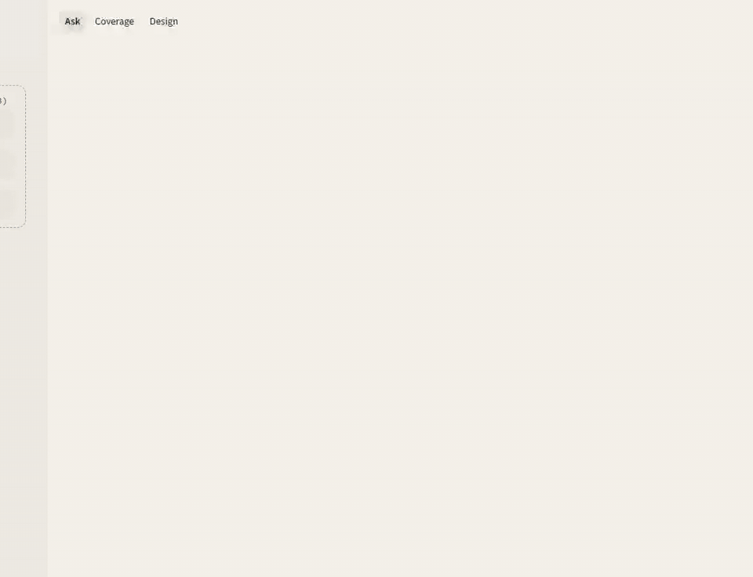
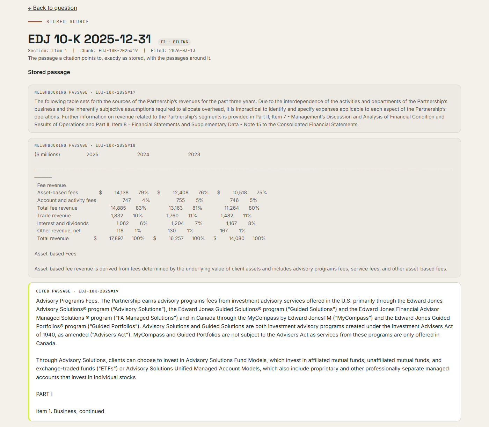
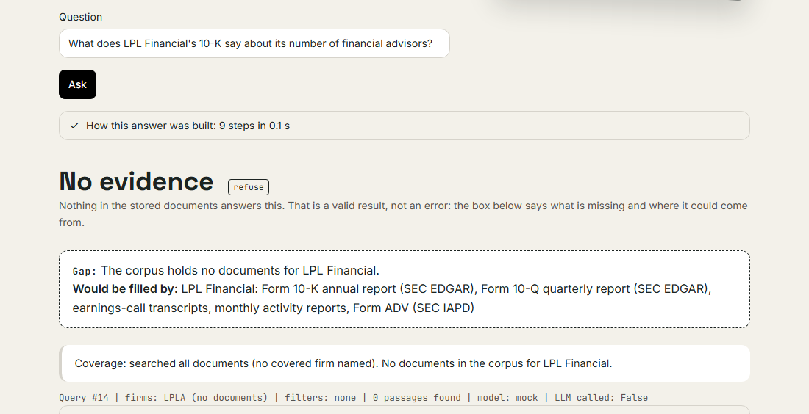
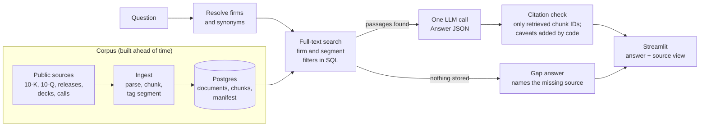

# Competitive Evidence Engine

A prototype that assembles and cites the public evidence behind a strategic question about
a wealth-management competitive set. Someone asks a question in plain language; the system
answers from a pre-built corpus of stored documents, and every claim links to the document
and passage it came from. When the corpus does not hold the evidence, it says so and names
the source that would fill the gap.

Built by a 7-person student team for the strategy function of a wealth-management firm
(referred to here as "the home firm"). Public sources only.

<p align="center">
  
</p>

<table>
  <tr>
    <td width="50%"></td>
    <td width="50%"></td>
  </tr>
  <tr>
    <td align="center"><sub>Every citation opens the stored passage it came from.</sub></td>
    <td align="center"><sub>No evidence is a valid answer: it names what is missing.</sub></td>
  </tr>
</table>

<sub>Screenshots use the mock provider (`LLM_PROVIDER=mock`), which quotes the top retrieved
passages instead of writing an answer. They show retrieval, citations and the gap path, not
answer quality.</sub>

## How it works



The rules behind the design are in [CLAUDE.md](CLAUDE.md); the details in
[docs/ARCHITECTURE.md](docs/ARCHITECTURE.md).

## Example: a firm that does not file on its own

Merrill has no filings of its own; it is reported inside Bank of America's Global Wealth &
Investment Management (GWIM) segment, which also holds the private bank. A question about
Merrill is handled like this:

```text
Question   What is Merrill's advisor growth strategy, and how has it changed?
Resolved   firms: MER
Filter     entity = MER  OR  (entity = BAC AND segment IN ('GWIM', 'Merrill'))   -- SQL, not prompt
Citation   BAC-10K-2025#246   "BAC 10-K - GWIM segment 2025-12-31 [filing]"
Caveat     GWIM is not Merrill: the segment also includes Bank of America Private Bank.
           (inserted by code from config/entities.yaml; in progress, #40)
```

The label always reads "BAC 10-K - GWIM segment", never "Merrill 10-K", and BAC passages
outside GWIM never reach a Merrill answer. Asked about a firm with no stored documents, the
engine answers "No evidence" and lists the filings that would close the gap
([second screenshot](docs/assets/gap.png)).

## Status

As of 2026-11-21.

**Corpus.** Snapshot `corpus-2026-11-19` (#216) holds all 224 documents in `main`'s manifest
and 21,161 passages: SEC filings, Form ADV Part 2A brochures (#55), supplements, monthly
metrics, investor-day and quarterly decks, call transcripts, press releases, 90 days of trade
press (#57), advisor web pages and research reports. New in it: the last supplement pages that
print an advisor count for Morgan Stanley (4Q2020) and Bank of America (4Q2023), and Form ADV
Part 1A employee counts for the Morgan Stanley, Merrill and Schwab advisory firms, stored as
verbatim page extracts (#216). PDF passages carry the page they are on (#84); call transcripts
are cut by speaker turn, so a question and its answer are separate passages (#107). Gate 4 ran
on `corpus-2026-11-17` (219 documents, #200); the frozen Gate 3 corpus is `corpus-2026-11-16`
(137 documents, #120).

**Retrieval check (automated, not a gate score).** `scripts/eval_run.py` runs the 30
questions with the mock model and checks whether search returns the expected passages
and whether gap questions stay clear of wrong evidence. Latest run: 2026-11-19, snapshot
`corpus-2026-11-19`, `--as-of 2026-11-17`, the app's search budget and question planner:
29 PASS / 1 FAIL (Q19); document recall 0.937 on the tier-1 questions with an answer key;
gap questions refused correctly 5 of 5; no wrong-firm passage; 0 paid calls. This is the new
baseline (`evals/baselines/corpus-2026-11-19/`); each question's status and recall equal the same check
on `corpus-2026-11-17` (`evals/baselines/corpus-2026-11-17/`, kept for Gate 4).

**Gate scores.** Each answer is scored at acting quality (one the project lead would forward
with his name on it), per [docs/BRIEF.md](docs/BRIEF.md). Gate 3, checked in week 8 at the
corpus freeze (#120): any 18 of the 30 questions at acting quality, citations resolve. It was
scored **16/30** on `corpus-2026-11-16` (real run, scored by the TL agent, PR #195). Gate 4,
checked in week 11 (#121): at least 21 of 30, and the project lead used it unsupervised at
least once. It was scored **21/30** on the final snapshot `corpus-2026-11-17` (real run on
2026-11-18, scored by the TL agent; tier 1: 12/18), after the fixes #203, #204 and #205; the
unsupervised-use part is not checked here. All 30 answers with citations, scores and known gaps:
[docs/results/gate4-report.md](docs/results/gate4-report.md). After the W10 changes (search
budget, question planner, per-part gaps, headcount sources), the same 30 questions scored
**24/30** on `corpus-2026-11-19` (real run on 2026-11-19, scored by the TL agent; tier 1: 14/18;
ten questions read twice in review: the first read gave 25/30, the second read failed Q19 and the
TL kept it as FAIL): [docs/results/w10-report.md](docs/results/w10-report.md);
W11 (map-reduce: one extraction call per firm, corrective re-search, one reduce call) with DeepSeek `deepseek-v4-pro`, thinking on, on the same snapshot: **18/30** adjudicated (tier 1: 11/18; real run on 2026-11-20; blind full read by four scorers 19/30, a first scorer that truncated passages 20/30; the second read in review failed Q12). Three outputs were cut at the 64,000-token output cap (Q20, Q21 here; Q27 in hybrid). The same plans with hybrid-norerank on `exp/hybrid`: 22/30 adjudicated, 21/30 blind (#250 PR 2). The DeepSeek baseline before map-reduce (#243) scored 15/30: [docs/results/w11-report.md](docs/results/w11-report.md); next steps: [docs/NEXT.md](docs/NEXT.md). The "PASS 7 / FAIL 21" in the 2026-10-20 log is the retrieval
check on snapshot `corpus-2026-10-18`, not a gate score.

**Retrieval.** Postgres full-text search is the default on `main`. A hybrid mode (keyword +
embeddings, local, no external calls) is kept as an optional component on branch
`exp/hybrid`. In a separate comparison run ([#126 report](https://github.com/RENEGADES20/Competitive-Evidence-Engine-EDJ/blob/exp/hybrid/evals/hybrid-eval/corpus-2026-10-29/report.md),
`exp/hybrid` code, which includes a Q29 fix not yet on `main`, so full-text search scores
28/30 there vs. 27/30 on `main`; each mode at its default before tuning), hybrid without
the reranker ties full-text search at 28/30; median search time: hybrid 0.363 s,
full-text 0.342 s. The tech lead keeps it because hand-maintained synonyms scale poorly as the
corpus grows; it will be re-evaluated on a larger corpus with new questions.

The running log is in [docs/PROGRESS.md](docs/PROGRESS.md).

## Quick start (Windows PowerShell)

Full steps and "when it breaks": [docs/RUN.md](docs/RUN.md).

```powershell
py -3.11 -m venv .venv
.\.venv\Scripts\python.exe -m pip install -r requirements.txt
.\.venv\Scripts\python.exe -m pip install -e .
if (-not (Test-Path .env)) { Copy-Item .env.example .env }   # keeps an existing .env; mock works offline
# download the newest corpus-YYYY-MM-DD.dump from the team Box link into .\snapshots
powershell -ExecutionPolicy Bypass -File scripts\restore.ps1
.\.venv\Scripts\python.exe -m cee.smoke   # expect PASS
.\.venv\Scripts\python.exe -m streamlit run src\cee\app\streamlit_app.py
```

## Code map

| Path | What |
|---|---|
| `src/cee/ingest/` | EDGAR fetch, PDF parser, chunking, loading, manifest checks |
| `src/cee/retrieve/fts.py` | Entity resolution and full-text search with SQL hard filters |
| `src/cee/answer/` | Answer JSON, the single LLM call (mock / anthropic / openai / deepseek), citation checks |
| `src/cee/ask.py` | The end-to-end pipeline, logs every query |
| `src/cee/app/streamlit_app.py` | Web interface and source view |
| `db/schema.sql`, `docker-compose.yml` | Database |
| `scripts/*.ps1` | `restore`, `build-snapshot`, `ingest` |
| `tests/` | Offline tests (`python -m pytest -q`) |

## Documentation map

| File | What it is for |
|---|---|
| [CLAUDE.md](CLAUDE.md) | Ground rules, architecture invariants, which spec to read, branch rules |
| [PLANS.md](PLANS.md) | ExecPlan template used for every task |
| [docs/BRIEF.md](docs/BRIEF.md) | What we are building, use cases, firms, gates |
| [docs/ARCHITECTURE.md](docs/ARCHITECTURE.md) | Pipeline, schema draft, retrieval modes, reference projects |
| [docs/TEAM.md](docs/TEAM.md) | Roles and week-by-week tasks |
| [docs/RUN.md](docs/RUN.md) | Install, daily use, snapshots, troubleshooting, Gate 4 run |
| [docs/results/gate4-report.md](docs/results/gate4-report.md) | Gate 4 results: 30 answers with citations, scores, known gaps |
| [docs/NEXT.md](docs/NEXT.md) | What to build next |
| [docs/PROGRESS.md](docs/PROGRESS.md) | Status log and weekly scores |
| [docs/DECISIONS.md](docs/DECISIONS.md) | Architecture decision records (ADRs) |
| [docs/DASHBOARD.md](docs/DASHBOARD.md) | Project board setup, weekly checks, snapshot publishing |
| [specs/](specs/) | One spec per work area |
| [evals/questions.yaml](evals/questions.yaml) | The 30-question bank (append-only) |
| [config/entities.yaml](config/entities.yaml) | Firms, aliases, segments, caveats |
| [data/manifest.csv](data/manifest.csv) | List of every stored document |

## How to contribute

Everyone works through Claude Code:

1. Pick an issue assigned to you on the project board.
2. In Claude Code run `/start-task <issue#>`. It reads the issue and spec, writes an
   ExecPlan with you, and creates your branch.
3. Build and test with Claude Code.
4. Run `/finish-task`. It checks your proof of work, pushes the branch and opens a PR.
5. The tech lead reviews and merges. Nobody pushes to `main`.
