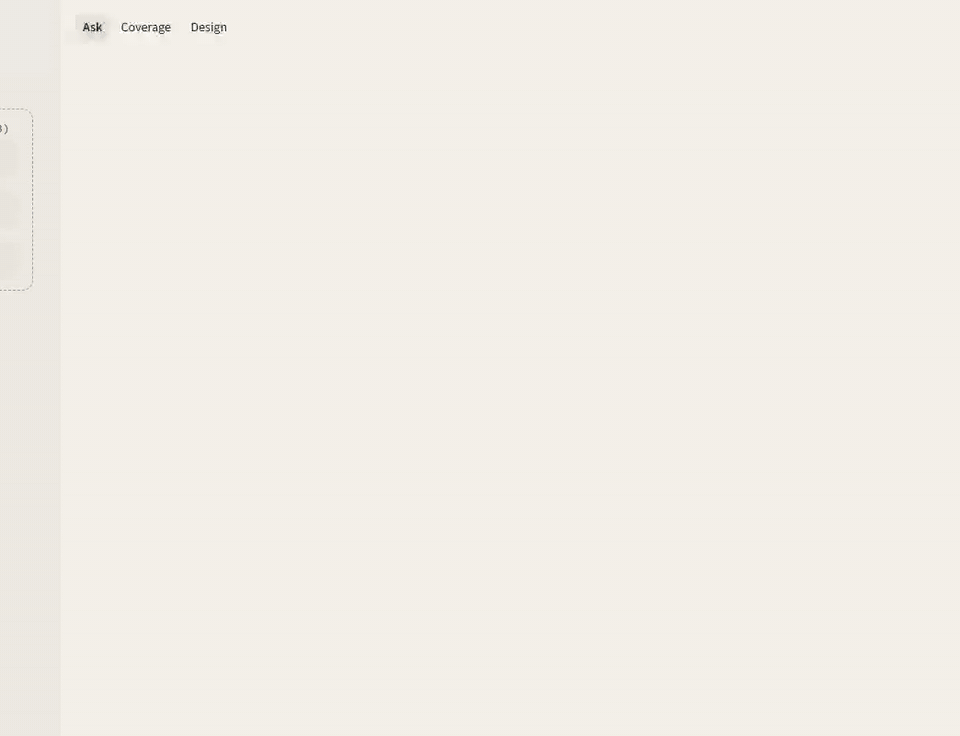
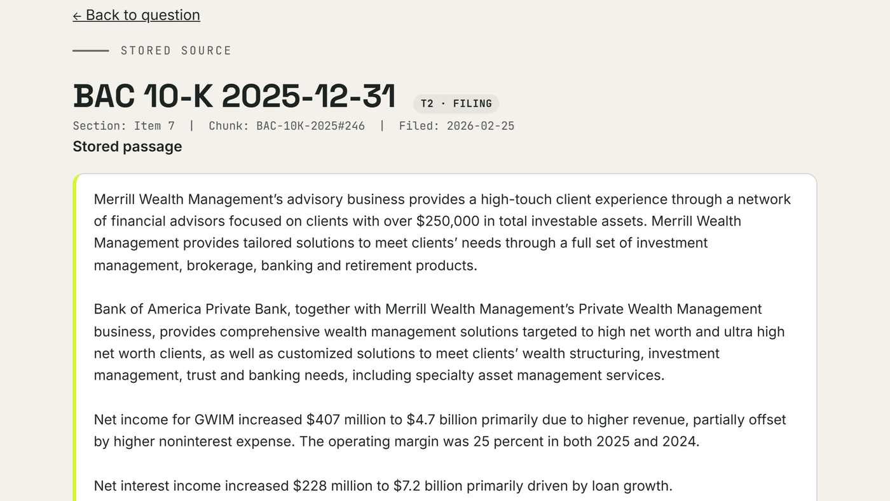
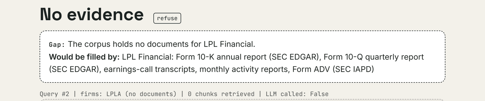
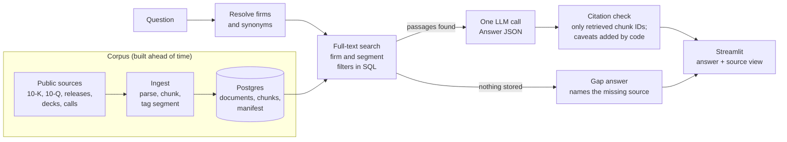

# Competitive Evidence Engine

A prototype that assembles and cites the public evidence behind a strategic question about
a wealth-management competitive set. Someone asks a question in plain language; the system
answers from a pre-built corpus of stored documents, and every claim links to the document
and passage it came from. When the corpus does not hold the evidence, it says so and names
the source that would fill the gap.

Built by a 7-person student team for the strategy function of a wealth-management firm
(referred to here as "the home firm"). Public sources only.

<p align="center">
  
</p>

<table>
  <tr>
    <td width="50%"></td>
    <td width="50%"></td>
  </tr>
  <tr>
    <td align="center"><sub>Every citation opens the stored passage it came from.</sub></td>
    <td align="center"><sub>No evidence is a valid answer: it names what is missing.</sub></td>
  </tr>
</table>

<sub>Screenshots use the mock provider (`LLM_PROVIDER=mock`), which quotes the top retrieved
passages instead of writing an answer. They show retrieval, citations and the gap path, not
answer quality.</sub>

## How it works



The rules behind the design are in [CLAUDE.md](CLAUDE.md); the details in
[docs/ARCHITECTURE.md](docs/ARCHITECTURE.md).

## Example: a firm that does not file on its own

Merrill has no filings of its own; it is reported inside Bank of America's Global Wealth &
Investment Management (GWIM) segment, which also holds the private bank. A question about
Merrill is handled like this:

```text
Question   What is Merrill's advisor growth strategy, and how has it changed?
Resolved   firms: MER
Filter     entity = MER  OR  (entity = BAC AND segment IN ('GWIM', 'Merrill'))   -- SQL, not prompt
Citation   BAC-10K-2025#246   "BAC 10-K - GWIM segment 2025-12-31 [filing]"
Caveat     GWIM is not Merrill: the segment also includes Bank of America Private Bank.
           (inserted by code from config/entities.yaml; in progress, #40)
```

The label always reads "BAC 10-K - GWIM segment", never "Merrill 10-K", and BAC passages
outside GWIM never reach a Merrill answer. Asked about a firm with no stored documents, the
engine answers "No evidence" and lists the filings that would close the gap
([second screenshot](docs/assets/gap.png)).

## Status

Week 5: the five-firm corpus (68 documents, 14,682 passages: SEC filings, earnings
releases, decks, supplements, call transcripts), Merrill tagged through the BAC GWIM
segment, synonym search and "the five" peer set, and an eval runner over the 30-question
bank. Weekly progress and the X/30 score are in [docs/PROGRESS.md](docs/PROGRESS.md).

## Quick start (Windows PowerShell)

Full steps and "when it breaks": [docs/RUN.md](docs/RUN.md).

```powershell
py -3.11 -m venv .venv
.\.venv\Scripts\python.exe -m pip install -r requirements.txt
.\.venv\Scripts\python.exe -m pip install -e .
if (-not (Test-Path .env)) { Copy-Item .env.example .env }   # keeps an existing .env; mock works offline
# download the newest corpus-YYYY-MM-DD.dump from the team Box link into .\snapshots
powershell -ExecutionPolicy Bypass -File scripts\restore.ps1
.\.venv\Scripts\python.exe -m cee.smoke   # expect PASS
.\.venv\Scripts\python.exe -m streamlit run src\cee\app\streamlit_app.py
```

## Code map

| Path | What |
|---|---|
| `src/cee/ingest/` | EDGAR fetch, PDF parser, chunking, loading, manifest checks |
| `src/cee/retrieve/fts.py` | Entity resolution and full-text search with SQL hard filters |
| `src/cee/answer/` | Answer JSON, the single LLM call (mock / anthropic / openai), citation checks |
| `src/cee/ask.py` | The end-to-end pipeline, logs every query |
| `src/cee/app/streamlit_app.py` | Web interface and source view |
| `db/schema.sql`, `docker-compose.yml` | Database |
| `scripts/*.ps1` | `restore`, `build-snapshot`, `ingest` |
| `tests/` | Offline tests (`python -m pytest -q`) |

## Documentation map

| File | What it is for |
|---|---|
| [CLAUDE.md](CLAUDE.md) | Ground rules, architecture invariants, which spec to read, branch rules |
| [PLANS.md](PLANS.md) | ExecPlan template used for every task |
| [docs/BRIEF.md](docs/BRIEF.md) | What we are building, use cases, firms, gates |
| [docs/ARCHITECTURE.md](docs/ARCHITECTURE.md) | Pipeline, schema draft, retrieval modes, reference projects |
| [docs/TEAM.md](docs/TEAM.md) | Roles and week-by-week tasks |
| [docs/RUN.md](docs/RUN.md) | Install, daily use, snapshots, troubleshooting |
| [docs/PROGRESS.md](docs/PROGRESS.md) | Status log and weekly scores |
| [docs/DECISIONS.md](docs/DECISIONS.md) | Architecture decision records (ADRs) |
| [docs/DASHBOARD.md](docs/DASHBOARD.md) | Project board setup, weekly checks, snapshot publishing |
| [specs/](specs/) | One spec per work area |
| [evals/questions.yaml](evals/questions.yaml) | The 30-question bank (append-only) |
| [config/entities.yaml](config/entities.yaml) | Firms, aliases, segments, caveats |
| [data/manifest.csv](data/manifest.csv) | List of every stored document |

## How to contribute

Everyone works through Claude Code:

1. Pick an issue assigned to you on the project board.
2. In Claude Code run `/start-task <issue#>`. It reads the issue and spec, writes an
   ExecPlan with you, and creates your branch.
3. Build and test with Claude Code.
4. Run `/finish-task`. It checks your proof of work, pushes the branch and opens a PR.
5. The tech lead reviews and merges. Nobody pushes to `main`.
