# Architecture

Updated for W11 (#270). Invariants are in [CLAUDE.md, Architecture invariants](../CLAUDE.md#architecture-invariants);
this file explains the design behind them. Decisions are recorded in [DECISIONS.md](DECISIONS.md).

## Pipeline

```mermaid
flowchart LR
    subgraph Build["Corpus (built ahead of time)"]
        direction TB
        S["Public sources<br/>filings, decks, calls, press, research"] --> I["Ingest<br/>parse, chunk, tag firm, segment, date"]
        I --> DB[("Postgres<br/>documents, chunks, manifest; dated snapshots")]
    end
    subgraph Find["1. Find the evidence"]
        direction TB
        Q["Question<br/>plain language"] --> R["Resolve firms<br/>aliases, segments, time window"]
        R --> P["Plan sub-questions<br/>aspects x firms"]
        P --> F["Search<br/>per sub-question, filters in SQL"]
    end
    subgraph Read["2. Read it, decide in code"]
        direction TB
        X["Extract per firm<br/>fact, not disclosed, not found, other figure"] --> C["Re-search<br/>empty cells, one round"]
        C --> M["Evidence matrix<br/>behavior, definitions, caveats"]
    end
    subgraph Write["3. Write and check"]
        direction TB
        W["Write the answer<br/>from the matrix only"] --> K["Check<br/>citations, numbers, caveats, gaps"]
        K --> U["Streamlit app<br/>answer, sources, coverage"]
    end
    DB --> F
    F --> X
    M --> W
    subgraph Legend
        direction TB
        k1[("Data")]
        k2["Code step"]
        k3["AI step"]
        k4["AI + code step"]
    end
    classDef data fill:#ECEAE3,stroke:#57534E,color:#1C2321
    classDef code fill:#FFFFFF,stroke:#1C2321,stroke-width:2px,color:#1C2321
    classDef ai fill:#D4F53C,stroke:#1C2321,color:#1C2321
    classDef aicode fill:#D4F53C,stroke:#1C2321,stroke-width:2px,stroke-dasharray:5 3,color:#1C2321
    class S,DB,Q,k1 data
    class I,R,F,M,K,U,k2 code
    class X,W,k3 ai
    class P,C,k4 aicode
```



The same diagram is in the README and on the app's Architecture page; the module text (what each
step does, who does it, the rule it enforces) lives in `src/cee/app/architecture.py`, and
`tests/test_architecture_page.py` checks that both diagrams use its labels. Principle: **AI reads
and writes; code decides and checks.**

W11 flow (ADR-021; the stages of `cee.ask`, shown live in the Ask page's progress trace):

| Stage | Who | What happens | Where |
|---|---|---|---|
| resolve | code | firms, segments, time window from aliases | `retrieve/fts.py` `resolve`, `config/entities.yaml` |
| decompose | AI + code | the planner names aspects (one call); code expands firms x aspects into sub-questions | `retrieve/planner.py` |
| search | code | each sub-question searched with entity, segment and time as SQL filters; full-text on `main`, hybrid on `exp/hybrid` | `retrieve/fts.py` `search` |
| extract | AI | one call per firm x aspect cell (#272; batches above `MAP_CALL_TOKENS`), strict schema: fact / not_disclosed / not_found / different_quantity; code rejects ids outside the cell's retrieved set and flags quotes and figures not in the cited passage | `answer/extract.py` |
| research | code + AI | one corrective re-search for `not_found` cells (wider words, used chunks excluded, same filters), then re-extraction | `answer/extract.py` `run_map` |
| matrix | code | behavior, metric definitions, what may be computed, caveats, gaps | `answer/matrix.py`, `config/metric_definitions.yaml` |
| synthesize | AI or code | one reduce call writes the answer from the matrix only; refuse, forecast requests, an undecided matrix or nothing to cite are written by code with no call | `answer/reduce.py` |
| check, caveats | code | citations only to retrieved chunk IDs (flagged, never dropped), number and date checks, caveats and gaps inserted | `answer/validate.py`, `answer/reduce.py` |
| log | code | the query, plan, every call with tokens and cost | `query_log`, `answer/cost.py` |

The number of model calls follows the question: one planner call, one extraction call per firm x aspect cell (#272),
re-extractions for re-searched cells, and at most one reduce call. `MAP=off` keeps the legacy
single answer call. With nothing retrieved the gap answer is built by code with no call.

## Schema draft

Sketch only; no migration files yet (the tech lead writes them in plans/0001).

```sql
CREATE TABLE entities (
  entity_id     text PRIMARY KEY,          -- MS, SCHW, EDJ, MER, BAC, RJF (config/entities.yaml)
  name          text NOT NULL,
  parent_id     text REFERENCES entities,  -- MER -> BAC
  reported_as   text,                      -- MER -> GWIM
  equivalence   text,                      -- 'full' | 'partial'
  caveat        text                       -- inserted by code when a substitute is used
);

CREATE TABLE documents (
  doc_id        text PRIMARY KEY,          -- stable, e.g. BAC-10K-2025
  entity_id     text NULL REFERENCES entities, -- NULL for thematic research
  doc_type      text NOT NULL,             -- 10-K, 10-Q, 8-K, transcript, deck, supplement, press, trade, research, adv
  source_tier   int  NOT NULL,             -- 1..6, see Source tiers below
  published_at  date NOT NULL,             -- required: recency and time windows depend on it
  period_end    date,
  url           text,
  storage_path  text NOT NULL,             -- raw/<entity>/<doc_id>.<ext> in the shared folder
  sha256        text NOT NULL
);

CREATE TABLE chunks (
  chunk_id      text PRIMARY KEY,          -- '<doc_id>#<n>'
  doc_id        text NOT NULL REFERENCES documents,
  section       text,                      -- chunks never cross a section
  segment       text NULL,                 -- e.g. GWIM, tagged at chunking time
  page          int,                       -- PDFs only
  text          text NOT NULL,             -- includes the context prefix
  tsv           tsvector GENERATED ALWAYS AS (to_tsvector('english', text)) STORED
);
CREATE INDEX ON chunks USING gin (tsv);

-- Optional vectors module (ADR-009), off by default: db/optional/vectors.sql, applied only
-- with CEE_VECTORS=on. The core schema has no extension and no vector type.
CREATE TABLE chunk_embeddings (
  chunk_id      text PRIMARY KEY REFERENCES chunks ON DELETE CASCADE,
  embedding     vector(384) NOT NULL       -- pgvector; BAAI/bge-small-en-v1.5 (#124)
);
CREATE INDEX ON chunk_embeddings USING hnsw (embedding vector_cosine_ops);

CREATE TABLE topics       (topic_id text PRIMARY KEY, label text, parent_id text);
CREATE TABLE chunk_topics (chunk_id text REFERENCES chunks, topic_id text REFERENCES topics,
                           PRIMARY KEY (chunk_id, topic_id));

CREATE TABLE source_registry (            -- what SHOULD exist per entity
  entity_id text, doc_type text, source_name text, url_pattern text, expected_cadence text,
  PRIMARY KEY (entity_id, doc_type, source_name)
);

CREATE TABLE query_log      (query_id serial PRIMARY KEY, asked_at timestamptz, question text,
                             mode text, filters jsonb, chunk_ids text[], answer jsonb,
                             snapshot text, model text);
CREATE TABLE query_feedback (query_id int REFERENCES query_log, rating int, comment text,
                             created_at timestamptz);
```

## Segment-level hard filter (the Merrill case)

Merrill does not file on its own; it lives inside Bank of America's GWIM segment, which also
contains Bank of America Private Bank. If retrieval returns any BAC chunk, the model will
happily present BAC consumer-bank hiring as "Merrill strategy" and it will read well (Q4, Q27).

So segment is tagged on each chunk when the document is chunked (C1 owns the tagging rules),
and retrieval filters on it in SQL:

```sql
-- Merrill question: only these chunks are eligible
WHERE d.entity_id = 'MER'
   OR (d.entity_id = 'BAC' AND c.segment IN ('GWIM', 'Merrill'))
```

The citation label then reads "BAC 10-K - GWIM segment", never "Merrill 10-K".

## Retrieval modes

Chosen by deterministic rules (entity/theme matching against `config/entities.yaml` and the
topics list), not by the LLM. Details in [specs/retrieval.md](../specs/retrieval.md).

| Mode | When | Filter | Quota |
|---|---|---|---|
| `entity` | Question names one or more firms | entity + segment hard filter | per entity |
| `theme` | No firm named, theme matched (Q16, Q18, Q20) | topic filter; research docs eligible | per topic |
| `entity+theme` | Both (Q12, Q21) | both parts retrieved separately | split between parts |

Search engine (the same filters in every engine): full-text search (`fts`) is the default and the
only engine on `main`. `exp/hybrid` adds `hybrid` (keyword + embeddings + a local reranker) and
`hybrid-norerank` (the same candidates ordered by fusion score), chosen by `RETRIEVAL_MODE` or
`scripts/eval_run.py --mode` (ADR-011). W11 scored runs (#250, adjudicated): fts 18/30 on `main`
([w11-report](results/w11-report.md)), hybrid-norerank 22/30 on `exp/hybrid`
([report](https://github.com/RENEGADES20/Competitive-Evidence-Engine-EDJ/blob/4d656d8/evals/hybrid-eval/corpus-2026-11-19/deepseek/report.md)).
How to run each: [RUN.md section 7](RUN.md#7-results-ask-with-the-real-model-and-reproduce-the-gate-4-run).

## Entity relation model

In `config/entities.yaml`:

- `parent`: MER's parent is BAC.
- `reported_as`: MER is reported as BAC segment GWIM.
- `equivalence: partial`: the reported segment is related but not the same thing.
- `caveat`: text that **code** appends whenever an answer uses substitute data, e.g.
  "GWIM is not Merrill: the segment also includes Bank of America Private Bank." (Q30)

## Chunking

- Three levels: cover / section / paragraph. A chunk never crosses a section boundary.
- PDFs keep the page number on every chunk (needed for the source viewer).
- Each chunk text starts with a template prefix, built by code, no LLM:
  `[entity|segment|doc_type|period]`, e.g. `[BAC|GWIM|10-K|2025-12-31]`.
  This follows Anthropic's
  [Contextual Retrieval](https://www.anthropic.com/news/contextual-retrieval): prepending
  context to each chunk improves retrieval; we use a cheap deterministic version.
- Data layers: `data/raw` -> `data/interim` -> `data/processed`, with `data/manifest.csv`
  so ingestion can resume where it stopped.

## Answer JSON

The answer has this shape: the reduce call writes it from the evidence matrix (or code builds it;
the legacy single answer call with `MAP=off`), via tool use / structured outputs; our code validates it. See [specs/answer-citations.md](../specs/answer-citations.md). `part_id` names
the planner part (ADR-020) an item answers (prompt v4, #215; "" in older outputs); a gap's `flags`
and `claim_text` are code-owned (a part with no claim or gap, an uncited grid cell moved to gaps).
`stop_reason` and `usage` are code-owned too (#230): why the model's output stopped and its token
counts, from the provider response ("" / {} for the mock and older outputs). An output cut at the
output cap, or one with no claims, adjacent items or gaps (a refusal aside), is rejected as invalid.

```json
{
  "answerable": true,
  "behavior": "answer | answer_with_boundary | gap_with_adjacent | refuse",
  "claims":   [{"text": "...", "chunk_ids": ["MS-TR-2025Q2#14"], "part_id": "p1", "source_label": "MS earnings call 2025-07-16"}],
  "adjacent": [{"text": "...", "chunk_ids": ["..."], "part_id": "p2", "differs_because": "net headcount change is not attrition"}],
  "gaps":     [{"what": "...", "suggested_source": "...", "part_id": "p2", "flags": ["part_gap"]}],
  "caveats":  ["inserted by code"],
  "stop_reason": "tool_use",
  "usage":    {"input_tokens": 60000, "output_tokens": 9000, "blocks": ["thinking", "tool_use"]}
}
```

## Source tier labels

Every citation shows its tier label: tier 1 `licensed`, 2 `filing`, 3 `IR`,
4 `trade press (indicative only)`, 5 `research`, 6 `signal`.

## Shared corpus flow (ADR-006)

1. Raw files live in the team's WashU OneDrive/Box folder as `raw/<entity>/<doc_id>.<ext>`.
2. `data/manifest.csv` (one row per document) is in git.
3. Corpus owners debug ingestion locally; changes land via PR.
4. Weekly, the tech lead rebuilds the database from `main` and publishes
   `snapshots/corpus-YYYY-MM-DD.dump` to the shared folder.
5. Everyone runs `/sync-db` (`scripts/sync-db.ps1` / `.sh`) to load it into local Docker
   Postgres: it reads `snapshots/LATEST.json` (committed: name, sha256, row counts, notes; the
   dump itself stays in the shared folder), checks the dump's sha256, restores it and runs the
   smoke test. Scores record the snapshot name.

## Reference projects by module

From the team's OSS research. None is copied whole; together they cover roughly 70% of the design.

| Module | Main reference | Secondary |
|---|---|---|
| Layout, env, collaboration | [bt4103-team8-sec-filing-assistant](https://github.com/niclow236/bt4103-team8-sec-filing-assistant) (layout, git rules), [earnings-intelligence](https://github.com/arnenyeck06/earnings-intelligence) (Docker Compose) | [Grounded-Rag-Analyst](https://github.com/Monesh76/Grounded-Rag-Analyst) (decision records) |
| Acquisition | [edgartools](https://github.com/dgunning/edgartools), [edgar-crawler](https://github.com/lefterisloukas/edgar-crawler); bt4103 resumable pipeline | - |
| Parsing and chunking | [sec_rag_assistant](https://github.com/lazfa04/sec_rag_assistant) (3-level chunks, pitfalls), bt4103 (no cross-section chunks) | [agentic-sec-rag](https://github.com/mr-j90/agentic-sec-rag) (chunk prefix), [Financial-Filings-RAG](https://github.com/AshishBhalala11/Financial-Filings-RAG) (page numbers) |
| Storage | Grounded-Rag-Analyst schema (tsvector first) | bt4103 data layers |
| Entity resolution and filters | agentic-sec-rag (deterministic resolution), sec_rag_assistant (retrieval-layer filter, per-entity quotas) | Own design: segments |
| Retrieval | Postgres FTS (ADR-001, ADR-010); Grounded-Rag-Analyst RRF evaluated on `exp/hybrid`, not adopted | [rag-pipeline-sec-filings](https://github.com/avivakahlon/rag-pipeline-sec-filings) (dedupe), [sec-edgar-rag](https://github.com/ankankisku-lab/sec-edgar-rag) (sub-questions) |
| Generation and citations | bt4103 (Pydantic templates), Grounded-Rag-Analyst (citation validator) | agentic-sec-rag (single LLM call) |
| Evidence gaps | agentic-sec-rag (coverage note), Grounded-Rag-Analyst (insufficient-evidence gate) | Own design: source registry |
| Front end | earnings-intelligence (Streamlit + feedback) | [sec-insights](https://github.com/run-llama/sec-insights) (highlight cited text) |
| Evaluation | earnings-intelligence (logs, feedback), bt4103 (review UI) | Grounded-Rag-Analyst (two-layer eval), rag-pipeline-sec-filings (LLM judge) |

Own design (no project to copy): non-SEC sources, theme index, segment attribution,
"which source would fill the gap".
